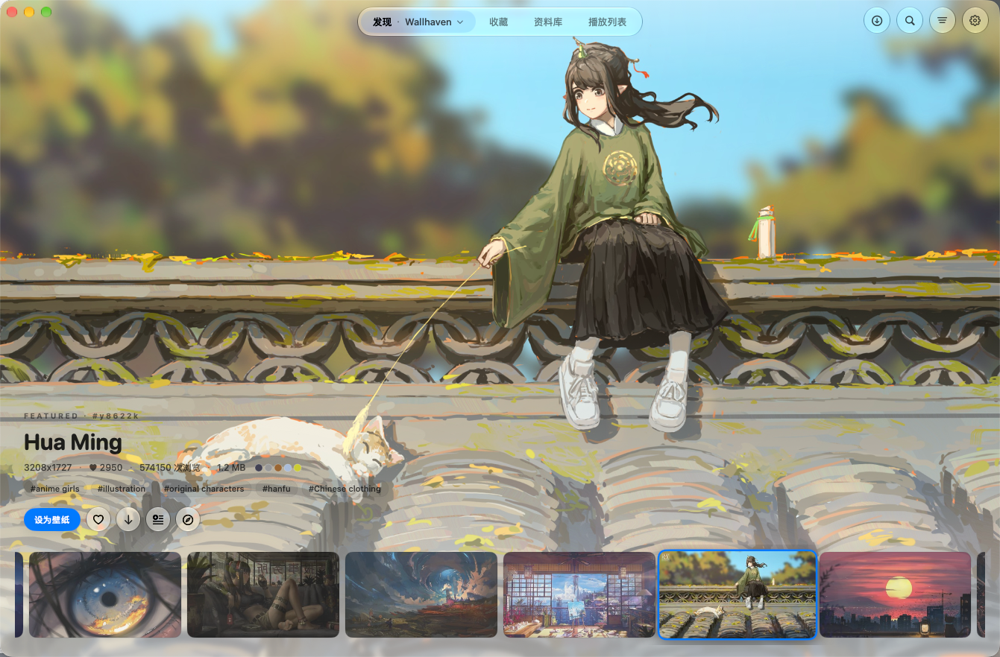
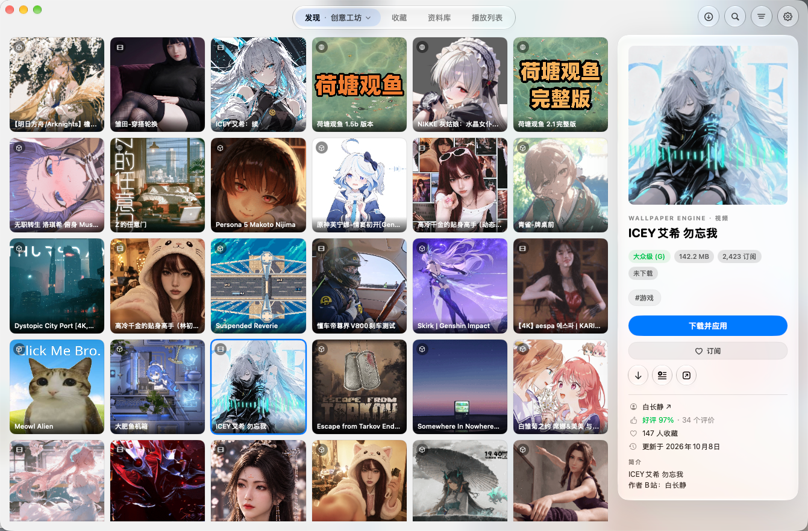

<p align="center">
  <picture>
    <source media="(prefers-color-scheme: dark)" srcset="docs/images/scena-icon-night.png">
    
  </picture>
</p>

<h1 align="center">Scena</h1>

<p align="center">让壁纸成为桌面上的风景。</p>
<p align="center">原生 macOS 壁纸应用 · Wallhaven · Steam 创意工坊 · 动态桌面 · 播放列表</p>
<p align="center">
  <a href="https://github.com/RoaycL/Scena/releases/latest">下载最新版</a> ·
  <a href="CHANGELOG.md">更新记录</a> ·
  <a href="https://github.com/RoaycL/Scena/issues">反馈问题</a>
</p>
<p align="center">macOS 14.0+ · Apple 芯片与 Intel · 支持应用内更新</p>

Scena 将高清图片、动态壁纸和本地素材放在一个应用中。你可以在 Wallhaven、Pixiv、Konachan、4K Wallpapers、MotionBG、Wallsflow 与 Wallpaper Engine 创意工坊中发现壁纸，管理收藏和订阅，导入自己的图片与视频，再用播放列表自动轮换桌面。

## 界面预览

### Wallhaven · 大图浏览

以壁纸为主角的大图预览，配合底部缩略图队列、标签和快捷操作。搜索与筛选收在顶部，预览支持自动轮播。



### 创意工坊 · 网格与详情

网格浏览壁纸，右侧集中展示预览、类型、分级和订阅信息，可直接订阅、下载或加入播放列表。



*以上为实际界面截图；截图中的壁纸版权归各自作者所有。*

## 主要功能

| 功能 | 说明 |
| --- | --- |
| 发现与筛选 | 多个在线图源及 Wallpaper Engine 创意工坊；按图源展示适用的筛选条件，分别记住搜索和排序；工坊支持显示或隐藏动漫内容 |
| 收藏与订阅 | 「全部」合并展示本地 Wallhaven 收藏与工坊订阅；支持收藏夹、Steam 订阅同步，以及从 Wallhaven 线上导入收藏 |
| 本地资料库 | 按来源管理下载内容，导入自己的图片、视频和已有的 Wallpaper Engine 文件夹 |
| 动态桌面 | 播放视频、工坊场景和网页壁纸，支持多显示器、音量、显示器开关及自动暂停 |
| 播放列表 | 侧栏管理多个列表，大图预览与横向缩略图队列；支持命名、多选、拖动排序、撤销及顺序或随机轮换 |
| 下载控制 | 单项或整组暂停、停止、恢复、重试；保存未完成任务，重启后可手动继续 |
| 主题与磨砂 | 日间、夜间或跟随系统；下载与筛选浮层透出模糊背景，应用图标始终跟随系统 |
| 桌面与维护 | 菜单栏控制、全局快捷键、开机启动、外接盘存储，以及带进度的应用内下载更新 |

## 下载与安装

**系统要求：macOS 14.0 或更高版本。Apple 芯片与 Intel Mac 使用同一个安装包。**

1. 前往 [最新发布页](https://github.com/RoaycL/Scena/releases/latest)，下载 `Scena-版本号.zip`。
2. 解压，将 `Scena.app` 拖入「应用程序」目录后打开。
3. 如需校验文件，可使用发布页中的 `SHA256SUMS.txt`。

当前安装包使用 Apple Development 签名，尚未经过 Apple 公证。首次打开如遇系统安全检查，请确认文件来自本仓库的发布页，再到「系统设置 → 隐私与安全性」查看提示。

macOS 14 的适配已通过双架构编译和最低版本检查，尚未完成 macOS 14 实机验证。

### 应用内更新

进入「设置 → 关于」检查更新，可直接下载新版并重启安装；下载过程中显示进度及文件大小，也可取消。开启「自动下载更新」后，新版会在后台下载，完成后可选择立即重启，或稍后退出时安装。升级会保留原有设置与素材库。

从 Xcode 构建目录运行的开发版本会打开 GitHub 发布页，避免覆盖开发产物。

## 开始使用

### 浏览、收藏与本地导入

- **发现：** 在顶部来源菜单中选择 Wallhaven 或创意工坊。点击放大镜展开搜索，回车提交、Esc 收起；收起后保留搜索条件，小圆点提示当前有搜索词。
- **收藏：** 默认进入「全部」，合并本地 Wallhaven 收藏与工坊订阅；切换到单个来源后可继续管理收藏夹或订阅。
- **资料库：** 查看本地下载的内容，通过「＋」或菜单栏导入图片、视频，或添加已有的 Wallpaper Engine 文件夹。
- **播放列表：** 在缩略图右键菜单中添加壁纸。左侧选择、新建或重命名列表；队列支持单击预览、双击播放、拖动排序、Command 多选和 Shift 连选，移除后可用 ⌘Z 撤销。

大图预览默认每 5 秒切换，末尾循环；切页或切换来源后重新计时，搜索、筛选和菜单操作期间暂停。手动选择缩略图后，连续 1 分钟无操作才恢复轮播。**预览轮播不会自动更换桌面壁纸**；需要自动更换桌面时，请播放对应列表，并设置轮换间隔及是否随机。

### Wallhaven 账户

普通浏览和本地收藏不需要 API Key。如需将 Wallhaven 线上收藏导入 Scena，在「设置 → 账户」中填写 **API Key 和用户名**，再同步收藏。应用内的收藏操作保存在本地。

### Steam 创意工坊

浏览公开工坊内容不需要先登录。在「设置 → 账户」使用 Steam 手机 App 扫码，持久凭据保存在 macOS 钥匙串，重新启动时自动恢复；社区会话按需续签。凭据被撤销或过期后需要重新授权。

| 用途 | 配置方式 |
| --- | --- |
| 同步与管理订阅 | 默认手机扫码，也可选择 Steam 官方网页登录；Scena 不读取页面中输入的密码 |
| 扫码后的工坊下载 | 使用同一账号直接从 Steam CDN 下载，无需另装 SteamCMD；账号需要已购买 Wallpaper Engine |
| SteamCMD 兼容下载 | 未使用扫码登录时，安装 [SteamCMD](https://developer.valvesoftware.com/wiki/SteamCMD)，在设置中填写账号名，通过「在终端登录」完成密码和 Steam Guard 验证 |

SteamCMD 管理自己的独立登录缓存；网页登录成功不代表 SteamCMD 已登录。实现与验证说明见 [Steam 认证文档](docs/steam-authentication.md)。

Scena 与 Windows 上的 Wallpaper Engine 使用同一 Steam 账号的订阅列表。启用「自动下载其他设备上新订阅的壁纸」后，应用会先扫描本地素材，再将缺失的可播放内容加入下载队列。**同步的是订阅列表，壁纸文件仍需在每台设备上分别下载。**

### 下载暂停与恢复

打开顶部「下载任务」控制工坊单项或整组任务。Steam CDN 下载支持分片校验、进度与恢复；SteamCMD 下载暂停会终止当前进程并保留部分文件，恢复时由 SteamCMD 校验和复用。同批任务中断时，其他未完成条目会重新排队。

每批数量可在设置中选择 **1～10 项**。SteamCMD 同批共用一次登录、逐项下载；Steam CDN 使用受限并发。重启应用后，未完成任务可手动恢复。普通在线图源的下载使用缩略图或详情中的下载按钮，不属于工坊任务队列。

### Pixiv 与 Wallsflow

Pixiv 支持公开榜单和插画/漫画关键词搜索，下载作品第一页的原图；暂不支持多页漫画整本下载。男性向、女性向为综合榜，不显示不适用的类型筛选。在「设置 → 账户」中打开官方网页登录，验证成功后将凭据保存到系统钥匙串，启动时重新验证和恢复；若保存失败，会提示仅本次使用并提供重试。未登录时搜索最多浏览 10 页，登录后仍受 Pixiv 服务端及账号权限限制；当前搜索仅请求安全内容。真实账号登录与重启恢复尚未完成验收。

Wallsflow 当前作为实验性图源提供。遇到 Cloudflare 安全验证时，可在内置浏览器中手动完成；应用确认原页面可以正常访问后，关闭验证窗口会继续之前的搜索、下载或应用操作。取消验证则停止该操作，不会把验证页保存成视频。站点可能不接受验证后的原生网络请求，验证不保证成功；人工验证及真实下载尚未完成验收。

### 常用快捷键

以下快捷键用于主窗口；输入文字时，按键优先交给输入框。

| 操作 | 快捷键 |
| --- | --- |
| 展开搜索 | ⌘F 或 `/` |
| 收起搜索 / 关闭浮层 | Esc |
| 预览上一张 / 下一张 | ← / → |
| 设为壁纸 | Return |
| 隐藏 / 显示界面 | 空格 |
| 切换全屏 | F |
| 导入图片或视频 | ⌘O |

播放列表中的空格用于暂停或继续播放。全局快捷键可在「设置 → 通用」中自行配置。

## 存储与兼容性

### 素材保存位置

在设置中选择保存位置，可使用外接盘。选择统一存储位置后，素材按来源整理为：

```text
Scena/
├── Wallhaven/
├── Wallpaper Engine/
└── Imported/
```

### 工坊播放支持

- **视频：** 使用系统原生播放器，支持本地导入视频及工坊中的可识别视频文件。
- **场景与网页：** 通过 [webwallgl](https://github.com/oneincase/webwallgl) 在 WebKit 中渲染。
- **兼容性边界：** 复杂场景、特定效果或依赖 Windows 功能的内容可能无法完整呈现；Windows「应用」类型壁纸不支持播放。

遇到无法播放的内容，请在 [Issues](https://github.com/RoaycL/Scena/issues) 中提供工坊链接、macOS 版本和问题表现。

## 从源码构建

使用 Xcode 打开 `wallhaven.xcodeproj`，选择 `wallhaven` scheme。产品名称为 `Scena.app`，工程和 scheme 名称仍保留 `wallhaven`。Kingfisher 依赖由 Swift Package Manager 获取，本地构建需要配置自己的签名团队。

当前发布构建使用 Xcode 27.0；应用最低系统版本为 macOS 14.0。

当前源码还需要 Python 3 和 .NET SDK（`helpers/ScenaSteamService/global.json` 固定为 10.0.402，允许同一功能带的更新补丁）。先生成两种架构的认证组件及 Xcode 文件清单，再构建应用。普通用户安装打包后的 `.app` 无需安装 .NET 或 Python。

```bash
# 首次构建，或认证组件源码/依赖变更后执行
bash scripts/build-steam-service.sh
# dotnet 不在 PATH 时：SCENA_DOTNET=/路径/dotnet bash scripts/build-steam-service.sh

# 开发构建
xcodebuild -project wallhaven.xcodeproj -scheme wallhaven -configuration Debug build

# Apple 芯片与 Intel 双架构构建
xcodebuild -project wallhaven.xcodeproj -scheme wallhaven \
  -configuration Release -destination 'generic/platform=macOS' \
  ARCHS='arm64 x86_64' ONLY_ACTIVE_ARCH=NO build

# 单元测试
xcodebuild test -project wallhaven.xcodeproj -scheme wallhaven \
  -destination 'platform=macOS' -only-testing:wallhavenTests
```

<details>
<summary>发布维护</summary>

1. 更新工程的 `MARKETING_VERSION` 和 `CURRENT_PROJECT_VERSION`，在 [CHANGELOG.md](CHANGELOG.md) 添加说明。
2. 构建并校验 Release 安装包，提交代码和对应的 `v版本号` 标签。
3. 上传包含顶层 `Scena.app` 的 ZIP 到 GitHub Release，并附上说明和 `SHA256SUMS.txt`。
4. 核对线上版本、架构、签名及下载文件的完整性。

[`scripts/release.sh`](scripts/release.sh) 提供认证组件构建、应用打包和创建 Release 的辅助流程，支持 `--draft`。应用的更新功能读取本仓库最新的正式 Release。认证组件采用自包含运行时，会增加安装包体积；完整依赖许可随组件一起打包。

</details>

## 致谢

- [webwallgl](https://github.com/oneincase/webwallgl)（MIT）：Wallpaper Engine 场景与网页渲染。
- [Kingfisher](https://github.com/onevcat/Kingfisher)（MIT）：图片加载与缓存。
- [SteamKit2](https://github.com/SteamRE/SteamKit)（LGPL）：源码开发版的 Steam 扫码认证与社区会话；通过独立进程调用，依赖许可见应用内 `Contents/Resources/SteamService/`。
- [linux-wallpaperengine](https://github.com/Almamu/linux-wallpaperengine)、[RePKG](https://github.com/notscuffed/repkg)：目录与格式约定参考。

Scena 与 Steam、Wallpaper Engine、Wallhaven 均无官方关联。壁纸内容的版权归各自作者所有，请遵守作者及平台的使用要求。
